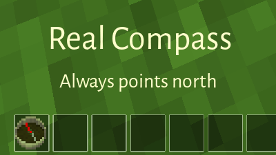

# Real Compass

**compass** *(n)* A mechanical or electronic instrument used for navigation or orienteering,
which points to the physical or magnetic north pole.

This is a fork of compassgps (and compass), with 90% of the code removed.

## Features

This mod tries to address what the "real" essence of being a compass is all about.

No options, no gui's, just an animated needle that points toward the north.



## Crafting guide

```text
+--------------+--------------+--------------+
|              | steel_ingot  |              |
+--------------+--------------+--------------+
| copper_ingot |    glass     | copper_ingot |
+--------------+--------------+--------------+
|              | copper_ingot |              |
+--------------+--------------+--------------+
```

## Licensing

See [REUSE.toml](/REUSE.toml) for complete licensing information.

- Textures: derived from ccompass, textures [CC-BY-SA-3.0](/LICENSES/CC-BY-SA-3.0.txt) by tacotexmex (changes by kestral246 also [CC-BY-SA-3.0](/LICENSES/CC-BY-SA-3.0.txt))
- Code: [CC0-1.0](/LICENSES/CC0-1.0.txt)

## Credits

- compassgps contributers
- Echo
- PilzAdams
- TeTpaAka
- Kilarin
- bell07
- kestral246

- [compassgps](https://github.com/Kilarin/compassgps) / Kilarin (Donald Hines),
et. al.
- [ccompass](https://github.com/minetest-mods/ccompass) / code: bell07, textures: tacotexmex
